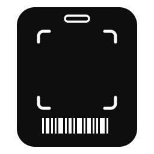
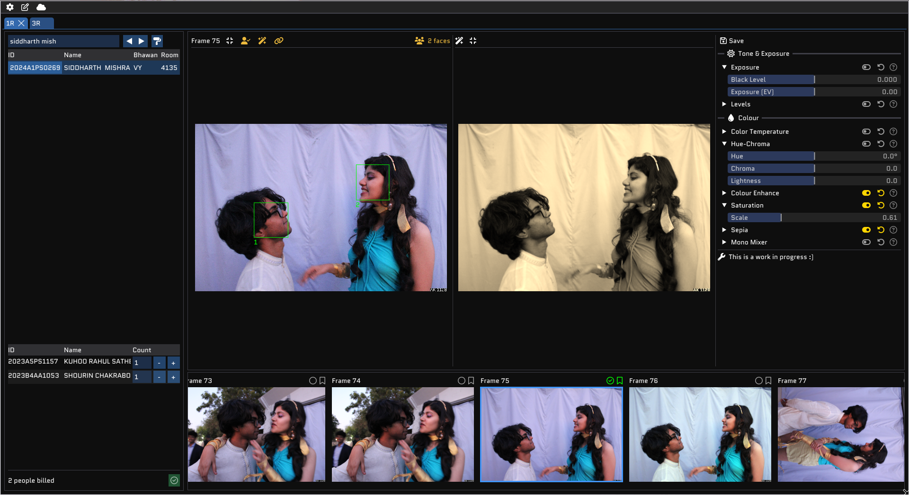

<p align="center">
  
</p>

<h1 align="center">UNFv3</h1>

<p align="center">
  <b>The Department of Photography Billing App</b><br>
  Assign IDs to people in photographs, edit images, export prints.
</p>

<p align="center">
  <a href="https://github.com/clodman84/Updated-Newer-Fresher-Version-3/releases/latest"></a>
  <a href="https://updated-newer-fresher-version-3.readthedocs.io/en/latest/"></a>
  <a href="License.txt"></a>
  
</p>

<p align="center">
  
</p>

---

After a photography event, every person in hundreds of photos needs an ID so the right prints reach the right person. UNFv3 is the tool the Department of Photography uses to do that: open a roll (of photos), tag the people in each frame, bookmark what's billed, touch up images, and export watermarked copies.

UNFv3 has been used for billing since v0.2.0-beta which started off as a rewrite of ([DoPyBITS/Billing-Software](https://github.com/DoPyBITS/Billing-Software)). v1.0.0 is a complete C++ rewrite of the application. This app is responsible for the delivery of over 20,000 images to the doorsteps of thousands of students every year.

## Features

### Browsing, Tagging and billing
- Search bar to look people up, with a custom language and parser to find people quickly.
- Automatic AI **face counting**.
- **Google Drive** connection to download rolls directly instead of waiting for the physical hard drive.
- **Image carousel** with efficient JPEG streaming that can handle very large images.

### Image editor
- Edits images in real time, GPU accelerated
- Simple by design

### Interface
- Tab-based UI for billing several rolls at once
- Full keyboard navigation, no mouse required
- GPU-accelerated rendering

### Performance

| | v0.x (Python) | v1.0.0 (C++) |
| --- | --- | --- |
| JPEG load (24 MP) | slow | **< 100 ms** |
| RAM usage | ~5.8 GB | **~98% lower** |
| Windows binary | ~200 MB | **~20 MB** |
| Rendering | CPU | **GPU accelerated** |

## Install

Download the latest build from the [Releases page](https://github.com/clodman84/Updated-Newer-Fresher-Version-3/releases/latest). Windows has an NSIS installer, and macOS builds are stable.

### macOS: "app is damaged" warning

macOS quarantines apps downloaded from the internet. Clear the flag once after downloading:

1. In Terminal, type `xattr -dr com.apple.quarantine ` (note the trailing space).
2. Drag the unzipped UNFV3 folder from Finder into the Terminal window to fill in the path.
3. Check the path is correct, then hit Enter.

You only need to do this the first time you run a new download.

## Documentation

Guides and reference: **[updated-newer-fresher-version-3.readthedocs.io](https://updated-newer-fresher-version-3.readthedocs.io/en/latest/)**

## Building from source

Linux, short version:

```bash
git clone https://github.com/clodman84/Updated-Newer-Fresher-Version-3.git
cd Updated-Newer-Fresher-Version-3
pipx install ninja

cmake -S . -B build -G Ninja \
    -DCMAKE_BUILD_TYPE=Release \
    -DUNFV3_ENABLE_LTO=ON \
    "-DCMAKE_TOOLCHAIN_FILE=$VCPKG_ROOT/scripts/buildsystems/vcpkg.cmake" \
    -DVCPKG_TARGET_TRIPLET=x64-linux-mixed \
    -DVCPKG_OVERLAY_TRIPLETS=./triplets/

cmake --build build --config Release
```

vcpkg fetches dependencies during configure. Windows (MinGW only, **MSVC is not supported**), macOS and packaging steps are in [BUILDING.md](BUILDING.md).

| Flag | Default | Description |
| --- | --- | --- |
| `UNFV3_ENABLE_LTO` | `ON` | Link-time optimization |
| `UNFV3_ENABLE_TRACY` | `OFF` | Tracy profiler support |
| `CMAKE_BUILD_TYPE` | `Release` | Use `Debug` for symbols |

## Roadmap

Planned for the next release:

- Clipboard integration: paste straight from WhatsApp into the search bar
- Helper showing available bhawan codes
- Wrong messlist detection
- Nickname feature (returning)
- Python scripting for the control desk
- RAW support: NEF, CR3, CR2
- Metadata tagging
- Editor: aspect ratio crop, auto angle correction, presets
- Contextual help on hover
- Documentation and tutorials
- Full Valgrind pass
- DOOM

Removed in v1.0.0 and possibly returning: audio player, genie, and nickname management.

## Contributing

Bug reports and PRs are welcome. For build problems, open an issue with your OS and version, compiler version, full configure/build output, and the exact failing step.

See [CHANGELOG.md](CHANGELOG.md) for release history.

## Built with

[SDL3](https://libsdl.org) · [Dear ImGui](https://github.com/ocornut/imgui) · [GEGL](https://gegl.org) · [vcpkg](https://vcpkg.io) · CMake + Ninja · NSIS

## License

See [License.txt](License.txt).
